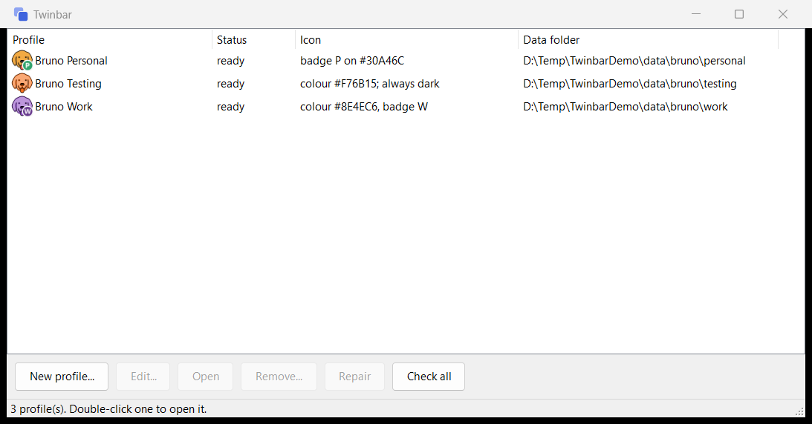

# Twinbar

[](https://github.com/sadrazkh/twinbar/actions/workflows/ci.yml)
[](https://github.com/sadrazkh/twinbar/releases/latest)
[](LICENSE)

A second, separately signed-in copy of your Electron apps on Windows: work and
personal Slack, two Claude or Postman accounts, a test login next to your real one.

Twinbar adds an entry such as **Postman Work** to the Start menu. It opens the
same installed app, with its own sign-in, settings and local data, and its own
taskbar button and icon. The original app isn't changed, and both can run at
the same time. Microsoft Store apps such as Claude work too.


> **Status: early releases (0.5.x).** All five phases are done; see
> [docs/phases.md](docs/phases.md). It's young: tested on Windows 11 with a
> handful of apps, so please report what doesn't work.

## Requirements

- Windows 10 or 11.
- Nothing else: Twinbar is one PowerShell script that runs with the Windows
  PowerShell 5.1 and .NET Framework built into Windows. No admin rights needed.
- The app must be built on Electron (Slack, Discord, Postman, Bruno, VS Code,
  Cursor, Figma, Signal, MongoDB Compass, Claude, ...).

## Get it

Download **`Twinbar-Setup-<version>.exe`** from the
[latest release](https://github.com/sadrazkh/twinbar/releases/latest) and run
it. It installs Twinbar for you only, with no admin rights, into
`%LOCALAPPDATA%\Programs\Twinbar`, puts **Twinbar** in the Start menu and opens
it; tick the option to also type `twinbar` in any terminal. Uninstall it from
Settings > Apps; your profiles stay and keep working.

The installer isn't code-signed yet, so Windows may say "Windows protected your
PC": click **More info**, then **Run anyway**.

Or download `twinbar-<version>.zip`, unpack it anywhere, and double-click
`twinbar.cmd` to open the window, or run `.\twinbar.cmd install -AddToPath`
there to install it the same way.

With [Scoop](https://scoop.sh), from the release's manifest (then
`twinbar install` for the Start menu entry):

```powershell
scoop install https://github.com/sadrazkh/twinbar/releases/latest/download/twinbar.json
```

Or from the source: `git clone https://github.com/sadrazkh/twinbar.git`, then
the same `.\twinbar.cmd install` in that folder.

Each release lists the files' SHA-256 in `SHA256SUMS` and has signed build
provenance: `gh attestation verify Twinbar-Setup-<version>.exe -R sadrazkh/twinbar`.

You can also use it without installing: `.\twinbar.cmd` runs `twinbar.ps1`
whatever your PowerShell execution policy is, and `.\twinbar.cmd gui` opens the
window.

## Use the window

Open **Twinbar** from the Start menu. **New profile...** lists the Electron apps
it found (**Find...** for any other); pick one, give the profile a name, and
choose its colour, badge, icon style and appearance while the preview shows the
result. The list shows your profiles and whether each is running; select one to
**Open**, **Edit**, **Remove** (it asks whether to delete the sign-in too) or
**Repair** it (it asks where the app went if it moved). **Check all** runs the
same checks as `twinbar doctor`.



## Use the command line

Make a profile. `-App` takes the app's `.exe`, its install folder or its Start
menu shortcut, or a Microsoft Store app's name (`twinbar apps` lists what it
finds):

```powershell
.\twinbar.cmd new -App "C:\Program Files\Bruno\Bruno.exe" -Name Work
.\twinbar.cmd new -App "$env:APPDATA\Microsoft\Windows\Start Menu\Programs\Postman\Postman.lnk" -Name Personal -Color green
.\twinbar.cmd new -App Claude -Name Work -Appearance dark
```

Then open **Bruno Work** from the Start menu (it's in the *Twinbar* folder), or:

```powershell
.\twinbar.cmd open "Bruno Work"
.\twinbar.cmd list
```

It gets a taskbar button of its own; pin it like any other.

Change its look, or repair it after the app moved or something got deleted;
`doctor` says what's wrong and what to run:

```powershell
.\twinbar.cmd change "Bruno Work" -Color red -Badge B
.\twinbar.cmd rebuild "Bruno Work" -App "D:\Apps\Bruno\Bruno.exe"
.\twinbar.cmd doctor
```

Remove a profile. Its sign-in is kept, so making the profile again brings it
back, unless you add `-DeleteData`:

```powershell
.\twinbar.cmd remove "Bruno Work"
.\twinbar.cmd remove "Bruno Work" -DeleteData
```

A profile can be named by its name (`Work`), its full name (`Bruno Work`) or
its id (`bruno.work`, shown by `list`). Names can use letters in any language,
digits, spaces, `.`, `_` and `-`.

| Command | What it does |
|---|---|
| `new -App APP -Name NAME` | Make a profile. See the options below. |
| `change PROFILE` | Change its `-Color`, `-Badge`, `-Style` or `-Appearance`. Its name and data stay; taskbar pins get the new icon too. |
| `rebuild PROFILE [-App APP]` | Make its shortcut, icon and launcher again. `-App` points it at the app's new place. |
| `rebuild -All` | The same for every profile; run it after updating Twinbar |
| `doctor [PROFILE]` | Check Twinbar and the profiles, and say how to fix what's wrong |
| `list [-Json]` | Show the profiles and whether each is running |
| `open PROFILE` | Start a profile |
| `remove PROFILE [-DeleteData]` | Remove a profile's shortcut and icon; with `-DeleteData`, its data too |
| `apps [-Json]` | The Electron apps found in the Start menu and the Microsoft Store, with what to give `-App` |
| `gui` | Open the Twinbar window |
| `install [-Dir DIR] [-AddToPath]` / `uninstall` | Install Twinbar for you, or remove it (profiles stay) |
| `help`, `version` | |

A running profile isn't changed, rebuilt or removed; quit it first.

Options for `new` (and, except the last three, `change`):

| Option | |
|---|---|
| `-Color C` | `blue`, `green`, `purple`, `orange`, `pink`, `teal`, `red`, `indigo`, `yellow`, `gray` or `#RRGGBB`. By default a colour is picked from the name. |
| `-Badge B` | 1 or 2 letters or digits. By default the name's first letter. |
| `-Style S` | `tint+badge` (default), `tint` (colour only), `badge` (original colours and a badge) or `original` (the app's own icon) |
| `-Appearance A` | `system` (default), `light` or `dark`. Works for apps that follow Windows' light or dark setting; apps with their own theme setting keep it per profile anyway. |
| `-DataDir DIR` | Keep the profile's data in another folder |
| `-AdoptDataDir` | Use a data folder that already has data in it |
| `-ShortcutDir DIR` | Put the shortcut somewhere other than the Start menu |

## How it works

Electron apps accept `--user-data-dir=<folder>`: everything the app keeps about
you (sign-in, settings, caches) then lives in that folder. A second folder means
a second, independent copy, and Electron's one-copy-at-a-time lock is per
folder, so both copies can run together.

The taskbar groups windows by their AppUserModelID. Electron apps set one for
the whole app, so on its own a second copy would join the original's button.
A profile's shortcut therefore starts a small **launcher**, which starts the app
and then puts the profile's own ID, name and icon on the app's windows. The
taskbar then shows them as a button of their own, and pinning it pins the
profile; the window's title bar and Alt+Tab show the profile's icon too. The
launcher only sets these window properties: it doesn't inject anything into the
app or change it. It stays in the background while the profile is open and
quits after it closes.

| | |
|---|---|
| Start menu entry | `Start Menu\Programs\Twinbar\<App> <Name>.lnk`. It starts the launcher with the profile's id and carries the profile's AppUserModelID (`Twinbar.<app>.<name>`). |
| Launcher | `%APPDATA%\Twinbar\bin\twinbar-launcher.exe`, compiled on your computer from the source inside `twinbar.ps1` the first time it's needed, and again after a Twinbar update. Its log is `%APPDATA%\Twinbar\logs\launcher.log`. |
| Icons | `%APPDATA%\Twinbar\icons\<app>.<name>-<hash>.ico`, drawn from the app's own icon, 16 to 256 pixels. The name changes with the look, so Windows never shows a stale icon. |
| Profile data | `%APPDATA%\Twinbar\data\<app>\<name>\`, with a small `.twinbar-profile` marker file |
| Profile records | `%APPDATA%\Twinbar\profiles\<app>.<name>.json` |
| Normal installs | The app's own `.exe` is started. |
| Squirrel installs (Slack, Discord, Postman...) | The launcher in the app's install folder is started; it always runs the newest version, so profiles keep working after the app updates. |
| Microsoft Store apps (Claude...) | Started through Windows' package activation, with the profile's arguments. Their data is kept in `%USERPROFILE%\Twinbar\<app>\<name>\`: Windows redirects what a Store app writes under AppData into the app's own package, where Twinbar couldn't see or remove it. |
| The Twinbar window | `Twinbar.exe` in the install folder, next to `twinbar.ps1`, compiled on your computer by `install`. It runs the script's window inside PowerShell without a console, with its own icon and taskbar button. |

Twinbar never modifies the app. Removing moves files to the Recycle Bin, and a
data folder is only ever removed if it carries that profile's marker.

## Limitations

- **Shared storage:** data an app keeps outside its data folder is shared
  between profiles, for example passwords some apps store in Windows
  Credential Manager, or settings in the registry. Of the apps tested, Bruno,
  Postman and Claude keep their sign-in in the data folder (encrypted with a
  key that's in there too), so each profile signs in on its own. Claude also
  refers to fixed folders (`%LOCALAPPDATA%\Claude-Data` and `Claude-3p`);
  whatever it keeps there is shared with the original Claude.
- **Appearance** only reaches apps that follow Windows' light or dark setting.
- **Window icon:** it's set by the launcher, so if the launcher is stopped while
  the profile is open, the window shows a blank icon until the profile is
  opened again.
- **After updating Twinbar,** run `twinbar rebuild -All`; profiles made with
  0.1.0 get their icon and taskbar button that way, and the sign-in is kept.
- Where policy blocks programs in your user folder (AppLocker and the like),
  the launcher and `Twinbar.exe` can't run.
- The first start of a freshly built `Twinbar.exe` or launcher can take a few
  seconds longer while Windows checks the new program.
- Tested so far on Windows 11 with Bruno 4.3 (normal install), Postman 12.33
  (Squirrel install) and Claude 6.28 (Microsoft Store).

## Tests

```powershell
powershell -NoProfile -ExecutionPolicy Bypass -File tests\smoke.ps1
powershell -NoProfile -ExecutionPolicy Bypass -File tests\smoke.ps1 -RealApp "C:\Program Files\Bruno\Bruno.exe" -Launch
```

The tests build a fake Electron app and work in temporary folders, never in
your Start menu, taskbar pins or profiles. A few small test files go to the
Recycle Bin. The fake app briefly shows a window, to check that it gets a
taskbar button and icon of its own. With `-RealApp ... -Launch`, the real app
(`-RealApp Claude` for the Store app) is opened once, signed out, with an empty
data folder, and closed again; a copy of it you already have open isn't touched.

CI runs these, with PSScriptAnalyzer, on every push and pull request. See
[CONTRIBUTING.md](CONTRIBUTING.md) for how the code is laid out and how a
release is made, and [SECURITY.md](SECURITY.md) to report a security problem.

## Credits and licence

Inspired by [DoppelDock](https://github.com/ZarinLab/doppeldock), which does
this on macOS. Twinbar is a separate project written from scratch for Windows,
and isn't affiliated with DoppelDock or with the makers of any app it works with.

[MIT](LICENSE)
